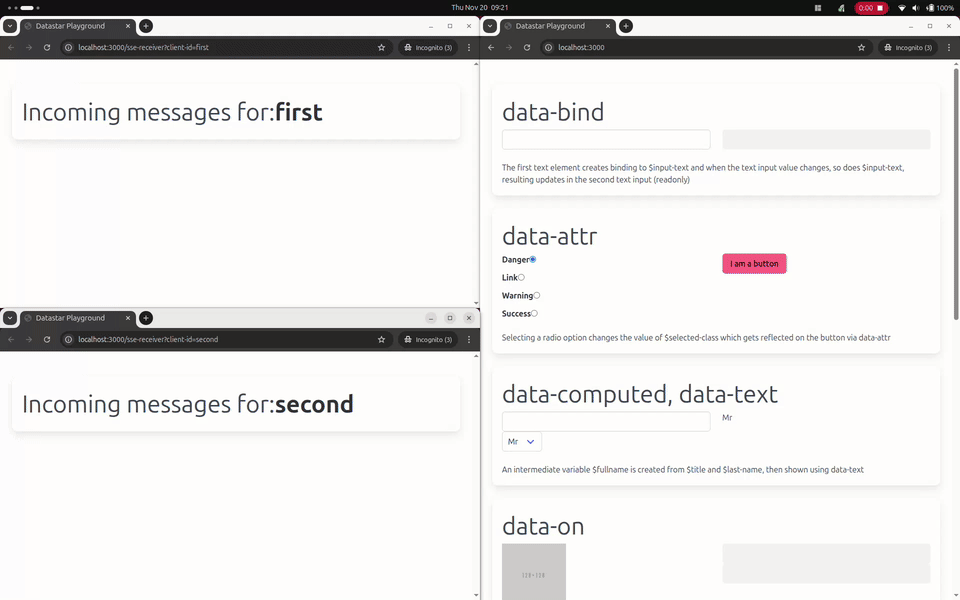

# Datastar Patterns

Different example, uses and design patterns for the fabulous [Datastar](https://data-star.dev/) framework in Clojure.

## Running

### Run the application

1. `clojure -M:dev -m datastar-patterns.main`
  - open http://localhost:3000

### REPL workflow

1. `clojure -M:dev -m nrepl.cmdline`
2. Call `(datastar-patterns.main/after-ns-reload)` to start
  - open http://localhost:3000
3. From there on, calling `(user/go!)` function will reload code & restart the web server

## Screenshot

